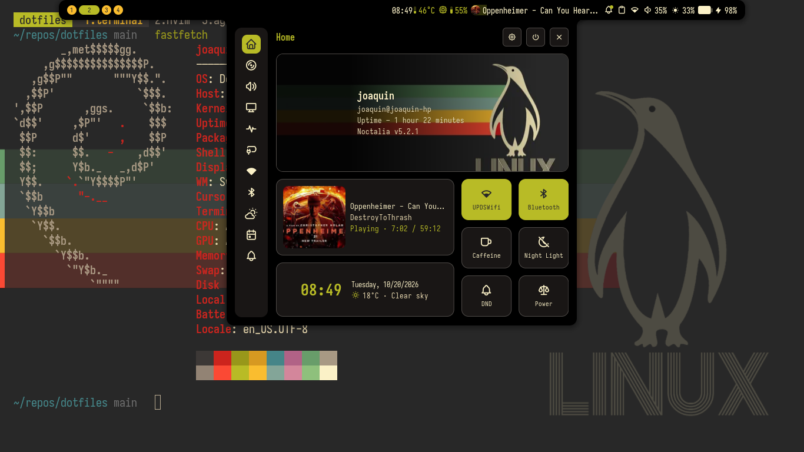

<p align="center">
  
</p>

# Dotfiles — Sway + Noctalia v5 & SSH Servers

Modular, polished and professional work environment for **Debian 13 (trixie)** with the **Gruvbox Material Dark** palette.

The project includes a **guided 100% CLI installer** where you can customize your environment (Desktop or Server), pick your favorite prompt (**Starship** or **Oh My Zsh + p10k**), and toggle `[X]` / `[ ]` checkboxes for the extra tools you want (**Node.js, pnpm, Docker, OpenCode, Freebuff, Codex, AGY**).

> **No external dependencies such as GNU Stow:** synchronization is done with clean copies (`cp`) managed by [`bin/dot-sync`](bin/dot-sync) with **automatic backups** in `~/.dotfiles_backup/`.

> **Debian 13 only:** the installer deliberately supports only Debian 13 (trixie). Other distributions are rejected by a version guard instead of being partially supported.

---

## 🚀 Step-by-Step Installation

### Step 0: Prerequisites on a Clean Machine

#### Minimal Debian (netinst)
If you just installed Debian from the minimal image, `sudo` may not be configured. Run this once as `root`:

```bash
su -c "apt update && apt install -y sudo git curl && usermod -aG sudo $USER"
```
*(Log out and back in so the `sudo` group takes effect.)*

#### Machines that already have `sudo`
Just make sure `git` and `curl` are available:

```bash
sudo apt update && sudo apt install -y git curl
```

---

### Step 1: Clone the Repository

Clone over **HTTPS** (no SSH keys or extra configuration required):

```bash
mkdir -p ~/repos && cd ~/repos
git clone https://github.com/Joaquinfr87/dotfiles.git
cd dotfiles
```

---

### Step 2: Start the Guided CLI Installer

Run the main orchestrator:

```bash
./install.sh
```

The installer walks you through the following steps:

#### 1. Environment Selection
```text
>> STEP 1: Environment selection
  1) Full desktop environment (Sway + Noctalia + Greeter + Terminal)
  2) Server environment (terminal only for SSH, no graphical interface)
  3) Synchronize configurations (with automatic backup)
  4) Extra tools menu (install only Node, Docker, AI tools...)
  5) Reset the system (uninstall and clean the environment)
  6) Exit
```
* **Full Desktop:** installs Sway, Noctalia v5, Noctalia Greeter (`greetd` login), PipeWire audio, the `bluetuith` Bluetooth TUI, Iosevka fonts (IosevkaTerm Nerd Font for the terminal, vanilla Iosevka for the GUI), Kitty and Zen Browser. It configures automatic resolution profiles for laptops (768p) and external monitors/desktops (1080p).
* **SSH Server:** installs only CLI tools, Neovim (LazyVim), Tmux with persistence and Git (no graphical packages).

#### 2. Shell and Prompt Selection
```text
>> STEP 2: Shell and prompt selection
  1) Starship (Recommended — Rust, < 20ms startup, Gruvbox theme)
  2) Oh My Zsh + Powerlevel10k (classic environment with OMZ plugins)
```

#### 3. Extra Tools Selector (interactive checkboxes)
```text
>> STEP 3: Extra tools and AI agents
Toggle a tool by typing its number [1-7]:

  [1] [X] Node.js LTS (JavaScript runtime via NVM)
  [2] [X] pnpm (fast package manager)
  [3] [X] Docker Engine + Docker Compose + Lazydocker
  [4] [X] OpenCode CLI (AI agent for the terminal)
  [5] [X] Freebuff CLI (AI agent for projects)
  [6] [X] Codex CLI (interactive AI agent)
  [7] [X] Antigravity CLI (agy)

  [A] Select all   [N] Deselect all
  [C] Continue with the installation (or press Enter)
  [S] Skip extra tools
```
* Type the corresponding number to toggle any tool between `[X]` and `[ ]`.
* Press **`C`** (or simply **`Enter`**) to start the unattended installation.

#### 4. Optional Boot Theme (opt-in)

After the desktop install, the installer asks whether to apply the boot theme. It is optional and can also be run later:

```bash
./install.sh --grub
```

This step installs:

* A **static Gruvbox GRUB theme** (`grub/themes/gruvbox`) using `Pictures/wallpaper3.png`, a plain high-contrast text menu (no opaque menu panel), Iosevka-based fonts when available, an orange highlighted selection and a timeout bar.
* A **Plymouth animated splash** using Plymouth's built-in spinner and Gruvbox colors. GRUB itself has no native animation engine; the animation starts after GRUB hands off to the kernel.
* The `splash` kernel option, `GRUB_GFXMODE=1920x1080,auto`, `GRUB_TERMINAL_OUTPUT=gfxterm` and `GRUB_TIMEOUT_STYLE=menu`.

The original `/etc/default/grub` is saved to `/etc/default/grub.dotfiles-backup` before any change. A reboot is required. To undo it:

```bash
sudo ./install/09-grub.sh --remove
```

> [!NOTE]
> GRUB 2 does not support animated GIF/video themes. Only the timeout progress bar moves inside GRUB; the looping animation is Plymouth.

---

### Step 3: Configure an SSH Key for GitHub (Optional)

After the installation, if you want to `git push` to your repositories without passwords:

```bash
# 1. Generate a modern Ed25519 key
ssh-keygen -t ed25519 -C "you@email.com"

# 2. Start the agent and add the key
eval "$(ssh-agent -s)"
ssh-add ~/.ssh/id_ed25519

# 3. Copy the public key:
# On Desktop (Wayland):
cat ~/.ssh/id_ed25519.pub | wl-copy

# On an SSH server (print it on screen to copy it):
cat ~/.ssh/id_ed25519.pub

# 4. Switch this repository's remote to SSH:
git remote set-url origin git@github.com:Joaquinfr87/dotfiles.git
```
*(Paste the key into: GitHub ➔ Settings ➔ SSH and GPG keys).*

---

## 🔄 Daily Management with `dot-sync` (No GNU Stow)

The [`bin/dot-sync`](bin/dot-sync) command (also available through the `dots` alias) keeps your system and the repository synchronized in both directions, safely:

| Command | Purpose |
| --- | --- |
| `dot-sync status` (or `dots status`) | Show which files are in sync, modified or missing. |
| `dot-sync diff` (or `dots diff`) | Show the exact code differences between your system and the repo. |
| `dot-sync deploy` (or `dots deploy`) | **Repo ➔ System:** deploy configs after creating a **backup** in `~/.dotfiles_backup/`. |
| `dot-sync save` (or `dots save`) | **System ➔ Repo:** copy changes made in `~/.config` back into the repository. |

### Typical workflow:
1. Make a change in your editor (for example in `~/.config/sway/config.d/04-bindings`).
2. Check what changed: `dot-sync diff`
3. Bring the changes into the repository: `dot-sync save`
4. Commit in Git: `git add . && git commit -m "feat: new keybind" && git push`

---

## 📁 Repository Layout

```text
dotfiles/
├── bin/                          # Helper commands in your $PATH
│   ├── dot-sync                  # Bidirectional synchronizer with automatic backups
│   └── tmux-sessionizer          # fzf project/session picker for Tmux
├── git/                          # Global Git configuration
│   ├── config                    # .gitconfig with aliases, delta and rebase
│   └── ignore                    # Global .gitignore (.DS_Store, *.local, etc.)
├── install/                      # Modular, idempotent installer scripts (Debian 13)
│   ├── 00-helpers.sh             # Logging, colors and Debian 13 checks
│   ├── 01-base-packages.sh       # Essential packages (git, curl, fzf, ripgrep, direnv, build-essential)
│   ├── 02-cli-tools.sh           # Neovim (bob/tarball), zoxide, eza, bat, lazygit, tmux plugins
│   ├── 03-shell.sh               # Native Zsh, Starship and plugins (supports --omz)
│   ├── 04-desktop-packages.sh    # Sway, Wayland, PipeWire, Kanshi, bluetuith, portals
│   ├── 05-noctalia.sh            # Noctalia v5 and Noctalia Greeter (greetd display manager)
│   ├── 06-fonts-wallpapers.sh    # IosevkaTerm (terminal), Iosevka (GUI) and Zen Browser
│   ├── 07-copy-configs.sh        # Copy with backup according to the profile (server/desktop)
│   ├── 08-dev-ai-tools.sh        # Node.js, pnpm, Docker, OpenCode, Freebuff, AGY, Codex
│   └── 09-grub.sh                # Optional Gruvbox GRUB theme + Plymouth splash
├── grub/                         # Opt-in boot theme (static GRUB + animated Plymouth)
│   ├── themes/gruvbox/           # GRUB theme: wallpaper3 background and theme.txt
│   └── plymouth/                 # Plymouth theme definition (reuses plymouth-themes spinner)
├── kanshi/                       # Automatic multi-resolution profiles (laptop 768p, desktop 1080p, dual)
│   └── config
├── kitty/                        # Kitty terminal (Gruvbox Dark theme and CSI-u keys)
│   ├── current-theme.conf
│   └── kitty.conf
├── noctalia/                     # Noctalia v5 configuration
│   ├── config.toml               # Look and feel, colors, shortcuts and launcher
│   └── settings.toml             # Bar, scaling and status plugin configuration
├── noctalia-greeter/             # greetd login manager configuration
│   └── greeter.toml
├── nvim/                         # Neovim (LazyVim, LSP, Blink, Obsidian, Gruvbox)
├── Pictures/                     # Gruvbox wallpapers and banner
├── starship/                     # Starship prompt configuration (Gruvbox Material Dark)
│   └── starship.toml
├── sway/                         # Sway tiling window manager (modular config.d/)
│   ├── config                    # Main file that includes config.d/
│   └── config.d/                 # 00-variables, 01-outputs, 02-input, 03-theme, 04-bindings, 05-floating, 06-autostart
├── tmux/                         # Tmux (resurrect/continuum persistence and sessionizer)
│   ├── README.md                 # Quick start
│   ├── GUIDE.md                  # Extensive tmux guide
│   ├── scripts/tmux-sessionizer  # fzf project/session picker
│   └── tmux.conf
├── agents.md                     # AI agent integration guide (OpenCode and Freebuff)
├── .gitignore                    # Git exclusions (.deb binaries, backups, .freebuff)
├── .zprofile                     # Login environment (runs sway only on tty1 and if present)
├── .zshrc                        # Ultra-fast interactive shell (native Zsh + Starship + direnv)
└── install.sh                    # Main 100% CLI installation orchestrator
```

---

## ⌨️ Key Keybinds (Sway + Wayland)

| Keybind | Action |
| --- | --- |
| `$mod+Return` | Open terminal (**Kitty**) |
| `$mod+Shift+Return` | Open **tmux-sessionizer** (fzf project picker) |
| `$mod+Shift+b` | Open browser (**Zen Browser**) |
| `$mod+d` | Open the application launcher (Noctalia) |
| `$mod+i` | Open the Control Center (Noctalia) |
| `$mod+comma` | Noctalia settings |
| `$mod+t` | Lock the screen |
| `Ctrl+Alt+Delete` | Session menu (Shutdown / Reboot / Suspend) |
| `Print` / `$mod+Print` | Screenshot region / full screen |
| `$mod+Shift+q` | Close the active window |
| `$mod+f` | Fullscreen |
| `$mod+Shift+space` | Toggle floating / tiling |
| `$mod+1…0` | Switch workspace |
| `$mod+Shift+1…0` | Move window to workspace |
| `$mod+Shift+c` | Reload the Sway configuration |

---

## 🖥️ Dynamic Display Management (Kanshi)

The **Kanshi** daemon automatically detects monitor connection and disconnection, instantly applying the right resolution, position and workspace assignment:

| Profile | Device / Output | Resolution | Behavior |
| --- | --- | --- | --- |
| `laptop` | Integrated display (`eDP-1`) | 1366x768 @ 60Hz | Default laptop mode (scale 1.0) |
| `desktop_hdmi` | Desktop PC with HDMI (`HDMI-A-1`) | 1920x1080 @ 60Hz | Native Full HD |
| `desktop_dp` / `desktop_dp2` | Desktop PC with DisplayPort (`DP-1`/`DP-2`) | 1920x1080 @ 60Hz | Native Full HD |
| `presentation` | Laptop + external HDMI monitor | Dual (768p + 1080p) | HDMI on the right, workspace 1 on the external monitor |
| `laptop_dp` | Laptop + external DP monitor (Dock/USB-C) | Dual (768p + 1080p) | DP on the right, workspace 1 on the external monitor |
| `laptop_clamshell` | Laptop with lid closed connected to HDMI | 1920x1080 @ 60Hz | Turns off `eDP-1` and keeps only the external monitor active |
| `desktop_dual` | Desktop PC with two monitors (DP + HDMI) | Dual 1080p | Primary DP (workspace 1), secondary HDMI |

---

## 🎧 Bluetooth & Terminal Utilities

* **Bluetooth TUI (`bluetuith`)**: run `bluetuith` in any Kitty terminal to scan, pair and connect Bluetooth headphones or peripherals with a lightweight interactive interface.
* **Fast Noctalia startup:** Noctalia registers a Bluetooth agent on startup. If `org.bluez` is not on the bus (because the `bluetooth` kernel module is not loaded), it waits 25 s and delays the whole bar. The installer loads the module, persists it in `/etc/modules-load.d/bluetooth.conf`, enables `bluetooth.service` and hooks it into `multi-user.target`. Verify with:
  ```bash
  systemctl status bluetooth
  cat ~/.cache/noctalia/noctalia.log | grep "startup phase"
  ```
  The `initServices` phase should take milliseconds, not ~25,000 ms.
* **Automatic environments (`direnv`)**: natively integrated into `.zshrc`. It detects `.envrc` files and loads variables or Python/Node virtual environments automatically when you enter your working directories.

---

## 🔒 Local Variables and Customizations

To keep tokens, API keys or private paths out of the public repository:
* **Shell:** create `~/.zshrc.local` (this file is read automatically by `.zshrc` and is ignored by Git).
* **Git:** create `~/.gitconfig.local` to set your name and email per machine:
  ```ini
  [user]
      name = Your Name
      email = you@email.com
  ```

---

## 🧹 Reset the System (Uninstaller)

If you want to test the installation again or clean the system without reinstalling the operating system:

```bash
./uninstall.sh
```
Or directly from the installer:
```bash
./install.sh --reset
```

> [!TIP]
> **What does `uninstall.sh` do?**
> - Stops and disables `greetd`, `noctalia-greeter` and PipeWire audio services.
> - Purges installed packages (`sway`, `noctalia`, `kitty`, etc.) and removes the Noctalia APT repositories.
> - Removes downloaded applications and binaries (`zen-browser`, `starship`, IosevkaTerm/Iosevka fonts, etc.).
> - Cleans `~/.config` configurations and restores the previous `~/.dotfiles_backup/` backup when `--restore-backup` is passed.
> - Reverts the optional GRUB theme and Plymouth splash and restores the saved `/etc/default/grub`.
> - Restores the default login shell to `/bin/bash`.
> - Supports `./uninstall.sh -y` for unattended mode or `./uninstall.sh --keep-extras` to keep Node.js and AI agents.
